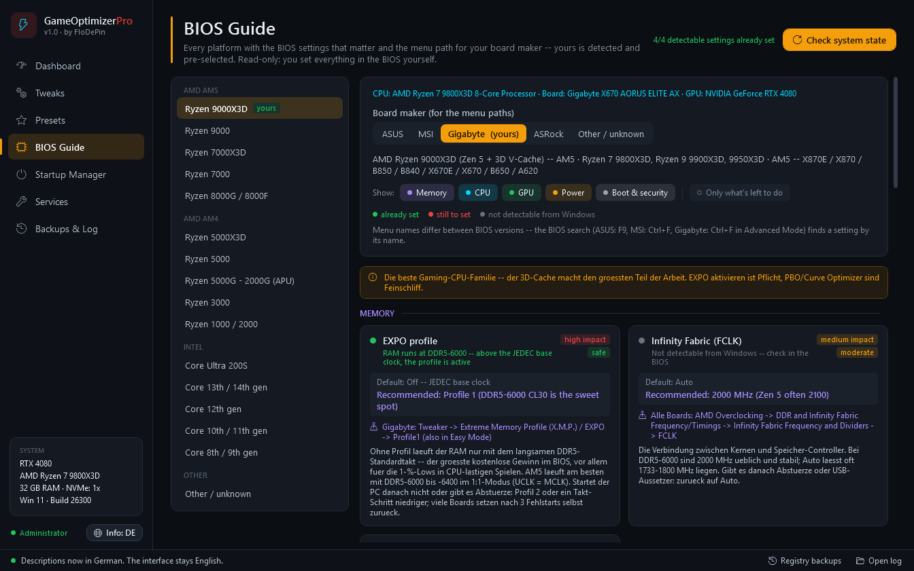

<div align="center">

# ⚡ GameOptimizerPro

**Windows- & Gaming-Optimierer in einem einzigen PowerShell-Skript.**<br>
111 Tweaks — jeder lässt sich rückgängig machen, und du siehst, welche aktiv sind.

[](https://github.com/FloDePin/GameOptimizerPro/releases/latest)
[](#-voraussetzungen)
[](#-voraussetzungen)
[](LICENSE)

🇬🇧 [English](README.md) · 🇩🇪 **Deutsch**


</div>

## 🚀 Schnellstart

**PowerShell** öffnen und einfügen:

```powershell
irm https://raw.githubusercontent.com/FloDePin/GameOptimizerPro/main/install.ps1 | iex
```

Der Installer lädt das Skript, prüft seine SHA256-Prüfsumme gegen [CHECKSUMS.txt](CHECKSUMS.txt) und startet es mit Administratorrechten (Windows fragt einmal nach). **Geändert wird erst, wenn du auf _Apply selected_ klickst** — und vorher legt das Tool einen Wiederherstellungspunkt und ein Registry-Backup an.

<details>
<summary><b>Lieber erst das Skript lesen, bevor es läuft?</b></summary>

```powershell
irm https://raw.githubusercontent.com/FloDePin/GameOptimizerPro/main/GameOptimizerPro.ps1 -OutFile GameOptimizerPro.ps1
Get-FileHash .\GameOptimizerPro.ps1 -Algorithm SHA256    # muss zu CHECKSUMS.txt passen
# danach in einer PowerShell, die als Administrator geöffnet ist:
powershell -ExecutionPolicy Bypass -File .\GameOptimizerPro.ps1
```

</details>

## ✨ Was GameOptimizerPro ausmacht

- ↩️ **Jeder Tweak lässt sich rückgängig machen** — alle 111 Tweaks haben ein eigenes Revert, das zum Windows-Standard zurückkehrt.
- 🟢 **Du siehst, was aktiv ist** — 101 Tweaks haben einen Live-Status, direkt aus Windows gelesen (Registry, Dienste, Energieplan), nicht aus einer Liste dessen, was du mal angeklickt hast.
- 🔄 **Merkt, wenn Windows Tweaks zurücksetzt** — Updates stellen gern Dinge zurück. Beim Start vergleicht das Tool mit deinem letzten Apply und bietet an, Zurückgesetztes neu anzuwenden.
- 🛟 **Sicherheitsnetz vor jeder Änderung** — ein Systemwiederherstellungspunkt plus ein `.reg`-Backup aller betroffenen Schlüssel, vor jedem Apply und Revert.
- 🧾 **Ehrliche Beschreibungen** — jeder Tweak sagt, was er tut, was er kostet und wo Windows ihn ignoriert (z. B. Richtlinien, die nur auf Enterprise / Education wirken).
- 🇬🇧 🇩🇪 **Englisch & Deutsch** — alle Tweak-Beschreibungen und der komplette BIOS Guide, live umschaltbar.

## 📸 Screenshots

<table>
<tr>
<td width="50%"><br><sub><b>Tweaks</b> — Status-Punkt, Badges und Beschreibung bei jedem Tweak; Suche über alle Kategorien</sub></td>
<td width="50%"><br><sub><b>Presets</b> — Minimal, Balanced, Aggressive mit Vorschau, was schon aktiv ist</sub></td>
</tr>
<tr>
<td width="50%"><br><sub><b>BIOS Guide</b> — deine Plattform vorausgewählt, Menüpfad für deinen Board-Hersteller, Live-Check von EXPO/XMP, ReBAR, CSM, Secure Boot</sub></td>
<td width="50%"><br><sub><b>Backups & Log</b> — Registry-Backups, Systemwiederherstellung, Revert all und Log an einem Ort</sub></td>
</tr>
</table>

<sub>Die Oberfläche ist englisch; die Beschreibungen der Tweaks und der BIOS Guide schalten mit „Info: DE“ auf Deutsch um.</sub>

## 🧰 Was drin ist

| Kategorie | Tweaks | Beispiele |
|---|:---:|---|
| 🪟 Windows | 46 | Debloat (Copilot, Recall, OneDrive, still nachinstallierte Vorschlags-Apps), Telemetrie & Datenschutz, die Windows-KI-Schalter, Ultimate Performance, HPET / Timer, Komfort |
| 🎮 Gaming | 12 | Spielmodus, MMCSS, CPU-Priorität, Vollbildoptimierungen, MSI-Modus, HAGS, NVIDIA Reflex, GPU-Timeout (TDR) |
| 🌐 Netzwerk | 11 | Nagle, LSO, Network Throttling, DNS (Cloudflare / Google), TCP, QoS, Energiesparen der Adapter |
| 💾 RAM & Speicher | 15 | Auslagerungsdatei, Speicherkomprimierung, TRIM, NVMe, Schreibcache, Ruhezustand + **Deep Clean** (6 Bereinigungen, jede zeigt die freigegebenen MB) |
| 🪟 Windows 11 | 7 | Klassisches Kontextmenü, Taskleiste links, Widgets, Start-Empfehlungen, Task beenden |
| 🔊 Audio | 6 | Audioverbesserungen, MMCSS-Audio, räumlicher Klang, Soundschema, Energiesparen der Geräte |
| 🖥️ GPU | 7 | 4 NVIDIA- + 3 AMD-Treiber-Tweaks — nur für die Grafikkarte, die du wirklich hast |
| ⚡ Energie | 7 | USB- / PCIe-Energiesparen, Festplatten- und System-Standby, Bildschirm-Timeout, CPU-Min / -Max |

<details>
<summary><b>Alle 111 Tweaks anzeigen</b> (Namen wie in der Oberfläche)</summary>

**🪟 Windows (46)**

- *Bloatware:* Remove Cortana · Remove Xbox Apps · Remove Microsoft Teams (Personal) · Remove Copilot · Remove OneDrive · Remove Windows Recall · Remove Other Bloatware · Stop Auto-Installed Suggested Apps · Disable Get Started & Copilot Sign-in Screens
- *Privacy:* Disable Telemetry & Data Collection · Disable Activity History · Disable Advertising ID · Disable Text & Image Generation (AI) · Disable Click to Do & Settings Agent (AI) · Disable AI in Paint & Notepad · Disable Location Tracking · Block Telemetry Hosts (hosts file) · Disable Scheduled Telemetry Tasks · Disable Windows Settings Backup (Cloud)
- *Performance:* Ultimate Performance Plan · Disable HPET (High Precision Event Timer) · Set 0.5ms Timer Resolution · Disable Prefetch & Superfetch · Optimize Visual Effects (Performance Mode) · Disable Windows Search Indexing · Disable Power Throttling · Disable Bing in Windows Search · Process Count Reduction (Svchost)
- *CTT Essentials:* Prevent Device Companion Apps · Disable Consumer Features · Disable Windows Platform Binary Table (WPBT) · Disable Store Recommended Search Results · Enable Start Menu Previous Layout · Disable File Explorer Automatic Folder Discovery · Run Disk Cleanup
- *Quality of Life:* Show File Extensions · Show Hidden Files · Disable Reserved Storage · Disable Storage Sense · Num Lock on Startup · Disable Lock Screen · Enable Long Paths
- *Mouse & UI:* Disable Mouse Acceleration · Disable Sticky Keys · Enable Dark Mode · Disable Transparency Effects

**🎮 Gaming (12)**

- *In-Game Boosts:* Enable Game Mode · Disable Xbox Game Bar · CPU Priority for Games (Win32Priority) · MMCSS Gaming Profile (High Priority) · Disable Fullscreen Optimizations · Disable Windows Update during Gaming · Disable Background App Throttling
- *GPU & Driver:* NVIDIA Low Latency Mode (Reflex) · Enable MSI Mode (Message Signaled Interrupts) · Enable Hardware-Accelerated GPU Scheduling (HAGS) · Clear Shader Cache · Increase GPU Timeout Tolerance (TDR)

**🌐 Netzwerk (11)**

- *Latency:* Disable Nagle's Algorithm (TCPNoDelay) · Disable Large Send Offload (LSO) · Disable Network Throttling Index
- *DNS:* Set DNS to Cloudflare (1.1.1.1) · Set DNS to Google (8.8.8.8) · Flush DNS Cache
- *TCP:* Disable TCP Auto-Tuning · Optimize TCP Settings (ECN/SACK/Timestamps)
- *QoS:* Disable QoS Packet Scheduler Limit
- *Adapter:* Disable Network Adapter Power Saving · Disable Delivery Optimization (P2P Windows Update)

**💾 RAM & Speicher (15)**

- *Page File:* Optimize PageFile (System Managed) · Clear PageFile on Shutdown
- *Memory:* Disable Memory Compression
- *SSD & NVMe:* Enable SSD TRIM · Disable Scheduled Defragmentation · Optimize NVMe Queue Depth · Disable Write-Cache Buffer Flushing
- *Maintenance:* Disable Hibernation · Clean Temp Files
- *Deep Clean:* Clean Browser Caches · Clean Windows Update Cache · Clean Thumbnail Cache · Empty Recycle Bin · Clean Prefetch Data · Clean System Logs & Crash Dumps

**🪟 Windows 11 (7)**

- *Taskbar & Shell:* Restore Classic Right-Click Menu · Left-Align Taskbar · Disable Widgets · Remove Chat Icon from Taskbar · Enable End Task in Taskbar
- *Start Menu:* Disable Recommended in Start Menu
- *Window Management:* Disable Snap Layout Hover Menu

**🔊 Audio (6)**

- *Latency & Quality:* Disable Audio Enhancements · Optimize MMCSS Audio Profile · Set Audio Service High Priority · Disable Spatial Sound (Windows Sonic)
- *System Sounds:* Disable Windows Sound Scheme
- *Power:* Disable Audio Device Power Save

**🖥️ GPU (7)**

- *NVIDIA:* NVIDIA: Disable Threaded Optimization · NVIDIA: Max Pre-Rendered Frames = 1 · NVIDIA: Shader Cache Size (Unlimited) · NVIDIA: Power Management = Max Performance
- *AMD:* AMD: Disable ULPS (Ultra Low Power State) · AMD: Shader Cache (Unlimited) · AMD: Anti-Lag (Low Latency Mode)

**⚡ Energie (7)**

- *USB & PCI:* Disable USB Selective Suspend · Disable PCI-E Link State Power Management
- *Storage:* Disable Hard Disk Sleep
- *Display:* Set Display Sleep = 15 Minutes
- *Sleep:* Disable Sleep (System)
- *CPU:* CPU Minimum Processor State = 100% · CPU Maximum Processor State = 100%

</details>

### 🎚️ Presets

| Preset | Tweaks | Für wen |
|---|:---:|---|
| 🟢 **Minimal** | 19 | Sichere Grundlagen: Datenschutz, Gaming-Priorität, Netzwerk-Latenz. Keine App-Entfernung — ideal für den ersten Lauf. |
| 🟠 **Balanced** | 82 | Minimal + Ultimate Performance, Timer, GPU- und Audio-Tweaks, leichtes Debloat (Copilot, Recall, Xbox) und die Windows-KI-Schalter. Die empfohlene Allround-Einstellung. |
| 🔴 **Aggressive** | 97 | Alles, inkl. Entfernen von Cortana / OneDrive / Teams, kein Ruhezustand, keine Speicherkomprimierung. Für erfahrene Nutzer. |

Ein Preset setzt nur die Haken — du prüfst die Liste und klickst selbst auf **Apply selected**.

### 🛠️ Werkzeuge

- 📊 **Dashboard** — Hardware-Überblick, Optimierungs-Score, Check der Bildwiederholrate, Live-Monitor für CPU / RAM / Datenträger / Netzwerk, Ping-Test (Latenz, Paketverlust, Jitter), Snapshot & Vergleich
- 🔧 **BIOS Guide** — 16 Plattformen (AM5, AM4, Intel LGA1851 / 1700 / 1200 / 1151), Menüpfade für ASUS, MSI, Gigabyte und ASRock, Live-Check von EXPO/XMP, Resizable BAR, CSM und Secure Boot. Nur lesend: das BIOS stellst du selbst um
- 🚀 **Autostart-Manager** — Run-Schlüssel und Autostart-Ordner, deaktivieren / aktivieren wie im Task-Manager, nichts wird gelöscht
- ⚙️ **Dienste** — fragt nach, bevor kritische Dienste wie Windows Update, BITS oder die Druckwarteschlange angefasst werden
- 🗄️ **Backups & Log** — Registry-Backups, Systemwiederherstellung, Revert all, Log-Datei

## 🛡️ Sicherheit

- **Wiederherstellungspunkt + Registry-Backup** vor jedem Apply und Revert — die `.reg`-Dateien liegen in `%LOCALAPPDATA%\GameOptimizerPro\RegistryBackups`
- **Entfernte Apps** (Cortana, OneDrive, …) sind das Einzige, was ein Revert nicht neu installieren kann — sie kommen per Systemwiederherstellung zurück. Diese Tweaks sind mit *removes app* markiert
- **SHA256-Kette** — `install.ps1` startet nur ein Skript, dessen Prüfsumme zu [CHECKSUMS.txt](CHECKSUMS.txt) passt
- **Kein Hintergrundprozess, keine Telemetrie** — die Prüfung auf zurückgesetzte Tweaks läuft nur, wenn du das Tool startest
- **Open Source** — eine lesbare PowerShell-Datei; jede Aktion steht im Log `%TEMP%\GameOptimizerPro_*.log`

## 📋 Voraussetzungen

- **Windows 11** oder **Windows 10 22H2** (reine Windows-11-Tweaks sind unter Windows 10 ausgegraut)
- **Windows PowerShell 5.1** — in Windows enthalten
- **Administratorrechte** — der Installer fragt danach
- GPU-Tab: Grafikkarte von **NVIDIA** oder **AMD** (mit Intel Arc funktionieren alle anderen Tweaks)

## ❓ Häufige Fragen

<details>
<summary><b>Wie mache ich alles rückgängig?</b></summary>

**Backups & Log → Revert all** setzt jeden Tweak auf den Windows-Standard zurück. Alternativ den Wiederherstellungspunkt *GameOptimizerPro Backup* in der Windows-Systemwiederherstellung nutzen.
</details>

<details>
<summary><b>Manche Tweaks haben einen grauen Punkt statt eines grünen oder leeren.</b></summary>

Grau heißt: Es gibt nichts Bleibendes zu prüfen (einmalige Bereinigungen) oder Windows kann den Status gerade nicht melden — zum Beispiel während Updates installiert werden. **Verify status** prüft erneut.
</details>

<details>
<summary><b>Microsoft Defender meldet „HostsFileHijack“.</b></summary>

Das kommt von *Block Telemetry Hosts*: Defender meldet hosts-Einträge, die Microsoft-Server blockieren. In Defender zulassen oder den Tweak zurücksetzen — die anderen Telemetrie-Tweaks wirken auch ohne ihn.
</details>

<details>
<summary><b>„Die Ausführung von Skripts ist auf diesem System deaktiviert“.</b></summary>

Passiert nur, wenn du die `.ps1`-Datei direkt startest. Dann `powershell -ExecutionPolicy Bypass -File .\GameOptimizerPro.ps1` verwenden — der Einzeiler oben ist davon nicht betroffen.
</details>

## 🧩 Auch von FloDePin

[**GameOptimizerPro v2**](https://github.com/FloDePin/GameOptimizerPro-v2) — eine eigenständige Desktop-App (Python) mit GPU-Auto-Tuner zum Übertakten und Undervolten über MSI Afterburner.

## 🤝 Feedback

Einen Fehler gefunden oder eine Idee? Öffne ein [Issue](https://github.com/FloDePin/GameOptimizerPro/issues) — bei Fehlern bitte die Windows-Version und die Log-Datei (`%TEMP%\GameOptimizerPro_*.log`) mitschicken. Was sich in jeder Version geändert hat: [Releases](https://github.com/FloDePin/GameOptimizerPro/releases). Ein Sicherheitsproblem? Bitte vertraulich melden — siehe [SECURITY.md](SECURITY.md).

## 📄 Lizenz

[MIT](LICENSE) © FloDePin — Nutzung auf eigene Gefahr. Lies die Beschreibungen, bevor du Tweaks anwendest; ein Wiederherstellungspunkt wird automatisch angelegt.
