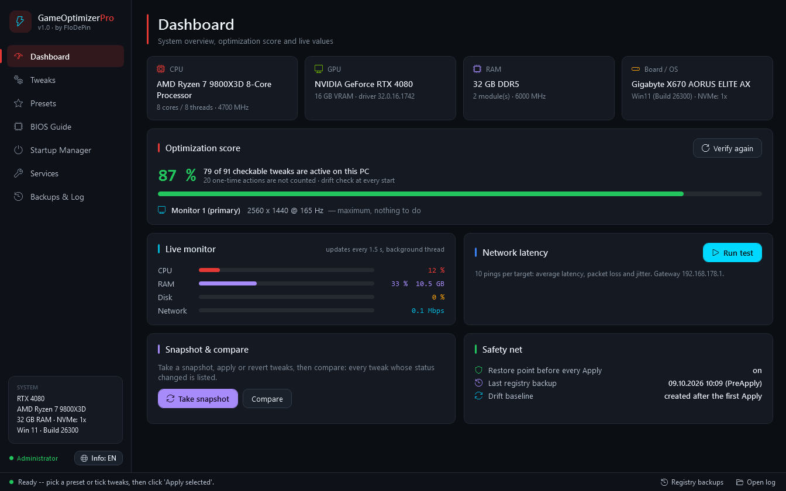
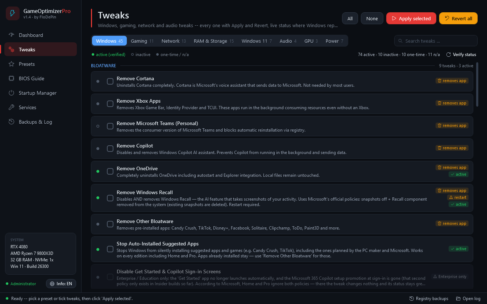
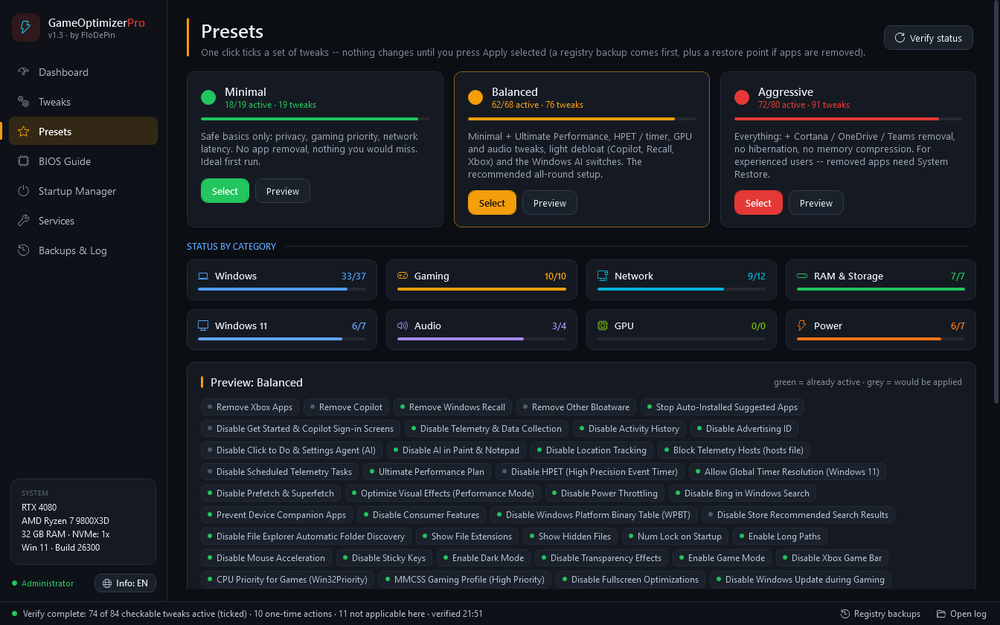
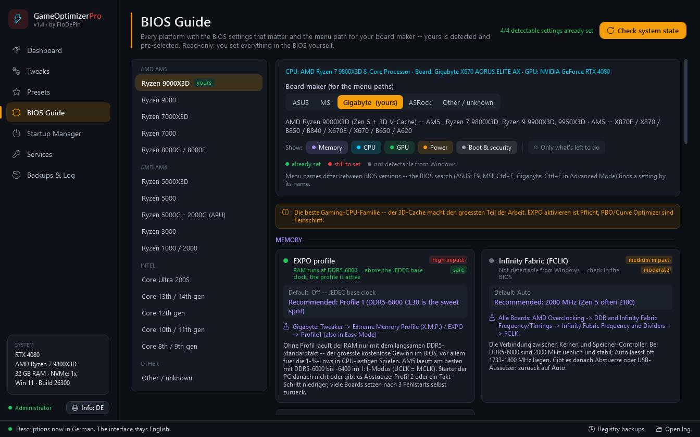
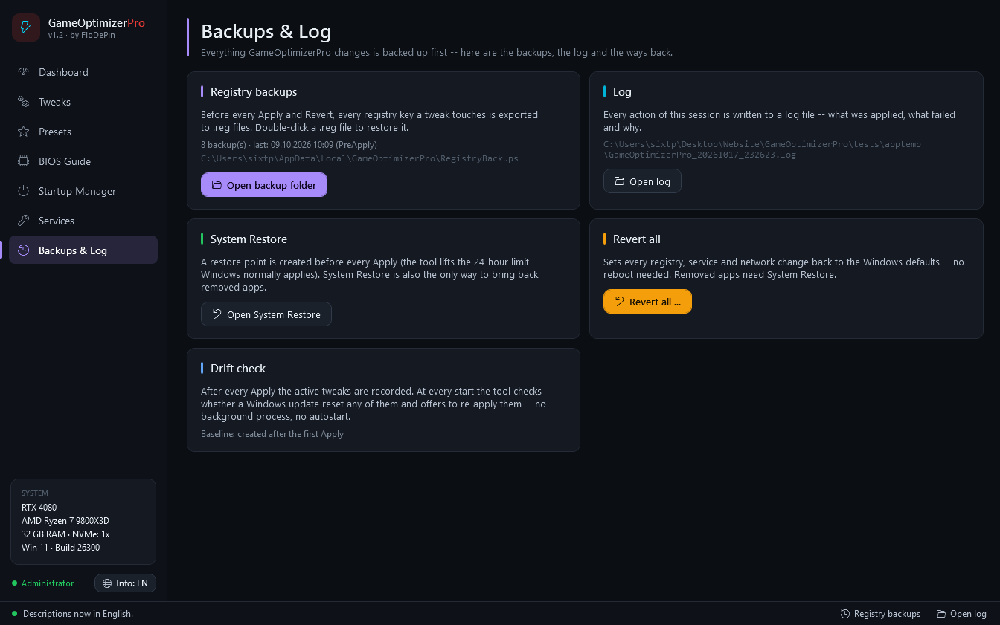

<div align="center">

# ⚡ GameOptimizerPro

**Windows- & Gaming-Optimierer in einem einzigen PowerShell-Skript.**<br>
108 Tweaks — jede Einstellung lässt sich rückgängig machen, und du siehst, welche aktiv sind.

[](https://github.com/FloDePin/GameOptimizerPro/releases/latest)
[](#-voraussetzungen)
[](#-voraussetzungen)
[](LICENSE)

[English](README.md) · **Deutsch**



</div>

## 🚀 Schnellstart

**PowerShell** öffnen und einfügen:

```powershell
irm https://raw.githubusercontent.com/FloDePin/GameOptimizerPro/main/install.ps1 | iex
```

Der Installer lädt das Skript, prüft seine SHA256-Prüfsumme gegen [CHECKSUMS.txt](CHECKSUMS.txt) und startet es mit Administratorrechten (Windows fragt einmal nach). **Geändert wird erst, wenn du auf _Apply selected_ klickst** — und vorher speichert das Tool ein Registry-Backup (plus einen Wiederherstellungspunkt, sobald Apps entfernt werden — ist der Computerschutz aus, fragt das Tool vorher).

<details>
<summary><b>Lieber erst das Skript lesen, bevor es läuft?</b></summary>

```powershell
irm https://raw.githubusercontent.com/FloDePin/GameOptimizerPro/main/GameOptimizerPro.ps1 -OutFile GameOptimizerPro.ps1
Get-FileHash .\GameOptimizerPro.ps1 -Algorithm SHA256    # muss zu CHECKSUMS.txt passen
# danach in einer PowerShell, die als Administrator geöffnet ist:
powershell -ExecutionPolicy Bypass -File .\GameOptimizerPro.ps1
```

</details>

## ✨ Was GameOptimizerPro ausmacht

- ↩️ **Jede Einstellung lässt sich rückgängig machen** — alle 108 Tweaks haben ein eigenes Revert zum Windows-Standard — alles, was das Tool angewendet hat, auf einmal (*Revert all*; was du selbst eingestellt hast, bleibt) oder nur die angehakten (*Revert selected*). Nur zwei Arten gehen in eine Richtung: App-Entfernungen (sie kommen über den Microsoft Store oder die Systemwiederherstellung zurück) und die Bereinigungen (gelöschte Cache-Dateien bleiben gelöscht).
- 🟢 **Du siehst, was aktiv ist** — 98 Tweaks haben einen Live-Status, direkt aus Windows gelesen (Registry, Dienste, Energieplan), nicht aus einer Liste dessen, was du mal angeklickt hast.
- 🔄 **Merkt, wenn Windows Tweaks zurücksetzt** — Updates stellen gern Dinge zurück. Beim Start vergleicht das Tool mit deinem letzten Apply und bietet an, Zurückgesetztes neu anzuwenden.
- 🛟 **Sicherheitsnetz vor jeder Änderung** — ein `.reg`-Backup aller betroffenen Schlüssel vor jedem Apply und Revert, dazu ein Systemwiederherstellungspunkt, sobald Apps entfernt werden.
- 🧾 **Ehrliche Beschreibungen** — jeder Tweak sagt, was er tut, was er kostet und wo Windows ihn ignoriert (z. B. Richtlinien, die nur auf Enterprise / Education wirken).
- 🌍 **Englisch & Deutsch** — alle Tweak-Beschreibungen und der komplette BIOS Guide, live umschaltbar.

## 📸 Screenshots

<table>
<tr>
<td width="50%"><br><sub><b>Tweaks</b> — Status-Punkt, Badges und Beschreibung bei jedem Tweak; Suche über alle Kategorien</sub></td>
<td width="50%"><br><sub><b>Presets</b> — Minimal, Balanced, Aggressive mit Vorschau, was schon aktiv ist</sub></td>
</tr>
<tr>
<td width="50%"><br><sub><b>BIOS Guide</b> — deine Plattform vorausgewählt, Menüpfad für deinen Board-Hersteller, Live-Check von EXPO/XMP, ReBAR, CSM, Secure Boot</sub></td>
<td width="50%"><br><sub><b>Backups & Log</b> — Registry-Backups, Systemwiederherstellung, Revert all und Log an einem Ort</sub></td>
</tr>
</table>

<sub>Die Oberfläche ist englisch; die Beschreibungen der Tweaks und der BIOS Guide schalten mit „Info: DE“ auf Deutsch um.</sub>

## 🧰 Was drin ist

| Kategorie | Tweaks | Beispiele |
|---|:---:|---|
| 🪟 Windows | 53 | Debloat (Copilot, Recall, OneDrive, still nachinstallierte Vorschlags-Apps, Tipps & Werbung), Telemetrie & Datenschutz, die Windows-KI-Schalter, Windows-Update-Steuerung, Hintergrund-Apps, Ultimate Performance, HPET / Timer, Komfort |
| 🎮 Gaming | 9 | Spielmodus, MMCSS, CPU-Priorität, Vollbildoptimierungen, MSI-Modus, HAGS, GPU-Timeout (TDR) |
| 🌐 Netzwerk | 11 | Nagle, LSO, Network Throttling, DNS (Cloudflare / Google, IPv4 + IPv6), TCP-Auto-Tuning, Energy-Efficient Ethernet, Interrupt Moderation, Energiesparen der Adapter |
| 💾 RAM & Speicher | 14 | Auslagerungsdatei, Speicherkomprimierung, TRIM, Schreibcache, Ruhezustand + **Deep Clean** (6 Bereinigungen, jede zeigt die freigegebenen MB) |
| 🪟 Windows 11 | 7 | Klassisches Kontextmenü, Taskleiste links, Widgets, Start-Empfehlungen, Task beenden, Dynamische Beleuchtung |
| 🔊 Audio | 4 | Audioverbesserungen, MMCSS-Audio, Priorität des Audiodienstes, Soundschema |
| 🖥️ GPU | 1 | AMD: ULPS (Ultra Low Power State). NVIDIA speichert seine Treiber-Einstellungen in der NVIDIA App, nicht in der Registry |
| ⚡ Energie | 9 | USB- / USB-3- / PCIe-Energiesparen, Festplatten- und System-Standby, Weck-Timer, Bildschirm-Timeout, CPU-Min / -Max |

<details>
<summary><b>Alle 108 Tweaks anzeigen</b> (Namen wie in der Oberfläche)</summary>

**🪟 Windows (53)**

- *Bloatware:* Remove Xbox Apps · Remove Copilot · Remove OneDrive · Remove Windows Recall · Remove Other Bloatware · Stop Auto-Installed Suggested Apps · Disable Tips, Ads & Suggestions · Stop OneDrive Folder Backup · Disable Get Started & Copilot Sign-in Screens
- *Privacy:* Disable Telemetry & Data Collection · Disable Activity History · Disable Advertising ID · Disable Text & Image Generation (AI) · Disable Click to Do & Settings Agent (AI) · Disable AI in Paint & Notepad · Disable Location Tracking · Block Telemetry Hosts (hosts file) · Disable Scheduled Telemetry Tasks · Disable Input & Speech Data Collection · Disable Remote Assistance
- *Performance:* Ultimate Performance Plan · Disable HPET (High Precision Event Timer) · Allow Global Timer Resolution (Windows 11) · Disable Prefetch & Superfetch · Optimize Visual Effects (Performance Mode) · Disable Startup App Delay · Disable Windows Search Indexing · Disable Power Throttling · Disable Bing in Windows Search · Process Count Reduction (Svchost) · Block Background Apps (Policy) · Stop Background Apps (All Editions)
- *Windows Update:* Exclude Drivers from Windows Update · Hold Feature Updates (Stay on Current Version) · Disable Automatic Windows Updates
- *CTT Essentials:* Prevent Device Companion Apps · Disable Consumer Features · Disable Windows Platform Binary Table (WPBT) · Disable Store Recommended Search Results · Disable File Explorer Automatic Folder Discovery · Run Disk Cleanup
- *Quality of Life:* Show File Extensions · Show Hidden Files · Disable Reserved Storage · Disable Storage Sense · Num Lock on Startup · Disable Lock Screen · Enable Long Paths
- *Mouse & UI:* Disable Mouse Acceleration · Disable Sticky Keys · Enable Dark Mode · Disable Transparency Effects · Alt+Tab Without Browser Tabs

**🎮 Gaming (9)**

- *In-Game Boosts:* Enable Game Mode · Disable Xbox Game Bar · CPU Priority for Games (Win32Priority) · MMCSS Gaming Profile (High Priority) · Disable Fullscreen Optimizations
- *GPU & Driver:* Enable MSI Mode (Message Signaled Interrupts) · Enable Hardware-Accelerated GPU Scheduling (HAGS) · Clear Shader Cache · Increase GPU Timeout Tolerance (TDR)

**🌐 Netzwerk (11)**

- *Latency:* Disable Nagle's Algorithm (TCPNoDelay) · Disable Large Send Offload (LSO) · Disable Network Throttling Index
- *DNS:* Set DNS to Cloudflare (1.1.1.1) · Set DNS to Google (8.8.8.8) · Flush DNS Cache
- *TCP:* Disable TCP Auto-Tuning
- *Adapter:* Disable Network Adapter Power Saving · Disable Delivery Optimization (P2P Windows Update) · Disable Energy-Efficient Ethernet · Disable Interrupt Moderation

**💾 RAM & Speicher (14)**

- *Page File:* Optimize PageFile (System Managed) · Clear PageFile on Shutdown
- *Memory:* Disable Memory Compression
- *SSD & NVMe:* Enable SSD TRIM · Disable Scheduled Defragmentation · Disable Write-Cache Buffer Flushing
- *Maintenance:* Disable Hibernation · Clean Temp Files
- *Deep Clean:* Clean Browser Caches · Clean Windows Update Cache · Clean Thumbnail Cache · Empty Recycle Bin · Clean Prefetch Data · Clean System Logs & Crash Dumps

**🪟 Windows 11 (7)**

- *Taskbar & Shell:* Restore Classic Right-Click Menu · Left-Align Taskbar · Disable Widgets · Enable End Task in Taskbar
- *Start Menu:* Disable Recommended in Start Menu
- *Window Management:* Disable Snap Layout Hover Menu
- *Devices:* Disable Dynamic Lighting

**🔊 Audio (4)**

- *Latency & Quality:* Disable Audio Enhancements · Optimize MMCSS Audio Profile · Set Audio Service High Priority
- *System Sounds:* Disable Windows Sound Scheme

**🖥️ GPU (1)**

- *AMD:* AMD: Disable ULPS (Ultra Low Power State)

**⚡ Energie (9)**

- *USB & PCI:* Disable USB Selective Suspend · Disable USB 3 Link Power Management · Disable PCI-E Link State Power Management
- *Storage:* Disable Hard Disk Sleep
- *Display:* Set Display Sleep = 15 Minutes
- *Sleep:* Disable Sleep (System) · Disable Wake Timers
- *CPU:* CPU Minimum Processor State = 100% · CPU Maximum Processor State = 100%

</details>

### 🎚️ Presets

| Preset | Tweaks | Für wen |
|---|:---:|---|
| 🟢 **Minimal** | 18 | Sichere Grundlagen: Datenschutz, Gaming-Priorität, Netzwerk-Latenz. Keine App-Entfernung — ideal für den ersten Lauf. |
| 🟠 **Balanced** | 73 | Minimal + Ultimate Performance, Timer, GPU- und Audio-Tweaks, leichtes Debloat (Copilot, Recall, Tipps & Werbung) und die Windows-KI- und Datenschutz-Schalter. Die empfohlene Allround-Einstellung. |
| 🔴 **Aggressive** | 89 | Alles, inkl. Entfernen von Xbox-Apps und OneDrive, keine Store-Apps im Hintergrund, keine Treiber über Windows Update, kein Ruhezustand, keine Speicherkomprimierung. Für erfahrene Nutzer. |

Ein Preset setzt nur die Haken — du prüfst die Liste und klickst selbst auf **Apply selected**. Schon aktive Tweaks bleiben, wie sie sind. Bewusst in keinem Preset: automatische Windows-Updates oder TCP-Auto-Tuning abschalten, die geplante Laufwerksoptimierung, Funktionsupdates anhalten, die DNS-Anbieter und ein paar Geschmacksfragen.

### 🛠️ Werkzeuge

- 📊 **Dashboard** — Hardware-Überblick, Optimierungs-Score (gemessen am empfohlenen Preset Balanced), Hinweis auf eine neuere Version, Check der Bildwiederholrate, Live-Monitor für CPU / RAM / Datenträger / Netzwerk, Ping-Test (Latenz, Paketverlust, Jitter), Snapshot & Vergleich (bleibt nach einem Neustart erhalten, z. B. über ein Windows-Update hinweg)
- 🔧 **BIOS Guide** — 16 Plattformen (AM5, AM4, Intel LGA1851 / 1700 / 1200 / 1151), Menüpfade für ASUS, MSI, Gigabyte und ASRock, Live-Check von EXPO/XMP, Resizable BAR, CSM und Secure Boot. Nur lesend: das BIOS stellst du selbst um
- 🚀 **Autostart-Manager** — Run-Schlüssel, Autostart-Ordner und die Autostart-Aufgaben von Store-Apps, deaktivieren / aktivieren wie im Task-Manager, nichts wird gelöscht; dazu die Startverzögerung, wo Windows eine gemessen hat
- ⚙️ **Dienste** — fragt nach, bevor kritische Dienste wie Windows Update, BITS oder die Druckwarteschlange angefasst werden; *Aktivieren* stellt die vorherige Starteinstellung wieder her
- 🗄️ **Backups & Log** — Registry-Backups, Systemwiederherstellung, Revert all, Log-Datei
- 💾 **Eigene Auswahl** — angehakte Tweaks als Textdatei speichern (Seite Presets) und nach einer Neuinstallation oder auf einem zweiten PC wieder anhaken

## 🛡️ Sicherheit

- **Registry-Backup** vor jedem Apply und Revert — die `.reg`-Dateien liegen in `%LOCALAPPDATA%\GameOptimizerPro\RegistryBackups` (die neuesten 20 dieses Tools, je rund 3 MB). Ein Doppelklick schreibt die gesicherten Werte zurück; `_remove-new-keys.reg` löscht Schlüssel, die es vorher noch nicht gab. **Ein Wiederherstellungspunkt** kommt dazu, sobald ein Apply Apps entfernt
- **Entfernte Apps** (OneDrive, Xbox, …) sind das Einzige, was ein Revert nicht neu installieren kann — sie kommen über den Microsoft Store (OneDrive: sein Installer) oder die Systemwiederherstellung zurück. Ist der Computerschutz aus, fragt das Tool, bevor es etwas entfernt. Diese Tweaks sind mit *removes app* markiert
- **SHA256-Kette** — `install.ps1` startet nur ein Skript, dessen Prüfsumme zu [CHECKSUMS.txt](CHECKSUMS.txt) passt, und zwar genau diese Bytes aus einem Ordner, in den nur Administratoren schreiben dürfen
- **Kein Hintergrundprozess, keine Telemetrie** — die Prüfung auf zurückgesetzte Tweaks läuft nur, wenn du das Tool startest. Die einzige Netzwerkanfrage: beim Start ein Blick auf GitHub, ob es eine neuere Version gibt (gesendet wird nichts)
- **Open Source** — eine lesbare PowerShell-Datei; jede Aktion steht im Log `%TEMP%\GameOptimizerPro_*.log`

## 📋 Voraussetzungen

- **Windows 11** oder **Windows 10 22H2** (reine Windows-11-Tweaks sind unter Windows 10 ausgegraut; Richtlinien, die Windows Home oder Pro ignoriert, sind dort ausgegraut und mit *Pro and up* / *Enterprise only* markiert)
- **Windows PowerShell 5.1** — in Windows enthalten
- **Administratorrechte** — der Installer fragt danach
- GPU-Tab: nur Grafikkarten von **AMD** (alle anderen Tweaks funktionieren mit jeder Karte)

## ❓ Häufige Fragen

<details>
<summary><b>Wie mache ich alles rückgängig?</b></summary>

**Backups & Log → Revert all** setzt jeden Tweak, den GameOptimizerPro angewendet hat, auf den Windows-Standard zurück; was du selbst eingestellt hast, bleibt. Entfernte Apps kommen über den Microsoft Store oder den Wiederherstellungspunkt *GameOptimizerPro Backup* (angelegt vor App-Entfernungen) in der Windows-Systemwiederherstellung zurück.
</details>

<details>
<summary><b>Manche Tweaks haben einen grauen Punkt statt eines grünen oder leeren.</b></summary>

Grau heißt: Es gibt nichts Bleibendes zu prüfen (einmalige Bereinigungen), der Tweak passt nicht zu diesem PC (AMD-Tweaks bei einer NVIDIA-Karte, ein Netzwerkadapter ohne diese Einstellung) oder Windows kann den Status gerade nicht melden — zum Beispiel während Updates installiert werden. Die Zähler führen einmalige Aktionen und „n/a“ getrennt auf. **Verify status** prüft erneut.
</details>

<details>
<summary><b>Microsoft Defender meldet „HostsFileHijack“.</b></summary>

Das kommt von *Block Telemetry Hosts*: Defender meldet hosts-Einträge, die Microsoft-Server blockieren. In Defender zulassen oder den Tweak zurücksetzen — die anderen Telemetrie-Tweaks wirken auch ohne ihn.
</details>

<details>
<summary><b>„Die Ausführung von Skripts ist auf diesem System deaktiviert“.</b></summary>

Passiert nur, wenn du die `.ps1`-Datei direkt startest. Dann `powershell -ExecutionPolicy Bypass -File .\GameOptimizerPro.ps1` verwenden — der Einzeiler oben ist davon nicht betroffen.
</details>

## 🧩 Auch von FloDePin

[**GameOptimizerPro v2**](https://github.com/FloDePin/GameOptimizerPro-v2) — eine eigenständige Desktop-App (Python) mit GPU-Auto-Tuner zum Übertakten und Undervolten über MSI Afterburner.

## 🤝 Feedback

Einen Fehler gefunden oder eine Idee? Öffne ein [Issue](https://github.com/FloDePin/GameOptimizerPro/issues) — bei Fehlern bitte die Windows-Version und die Log-Datei (`%TEMP%\GameOptimizerPro_*.log`) mitschicken. Was sich in jeder Version geändert hat: [CHANGELOG.md](CHANGELOG.md). Ein Sicherheitsproblem? Bitte vertraulich melden — siehe [SECURITY.md](SECURITY.md).

## 📄 Lizenz

[MIT](LICENSE) © FloDePin — Nutzung auf eigene Gefahr. Lies die Beschreibungen, bevor du Tweaks anwendest; ein Registry-Backup wird automatisch gespeichert, vor App-Entfernungen zusätzlich ein Wiederherstellungspunkt.
