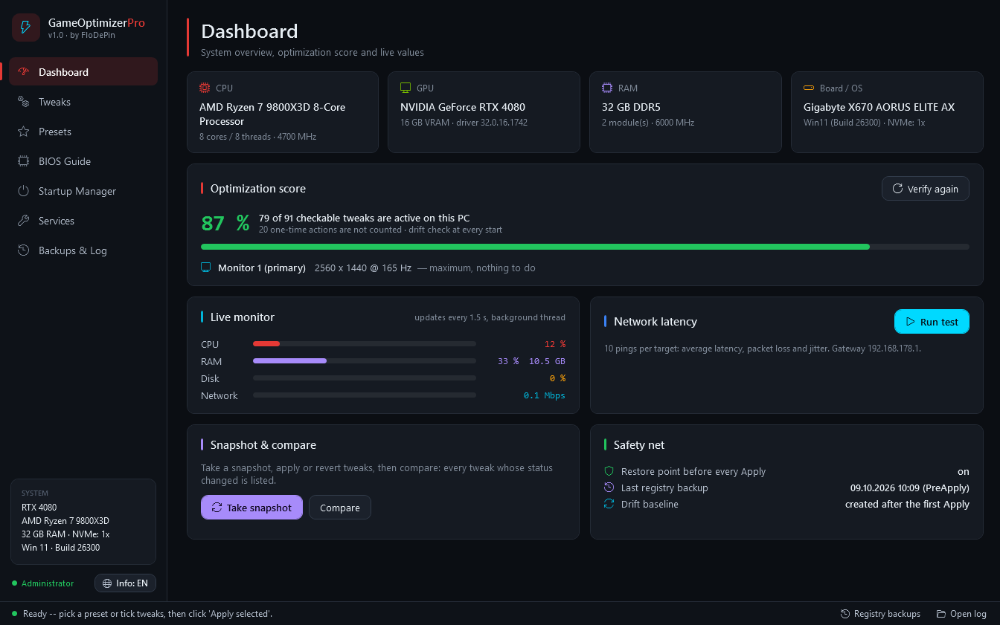
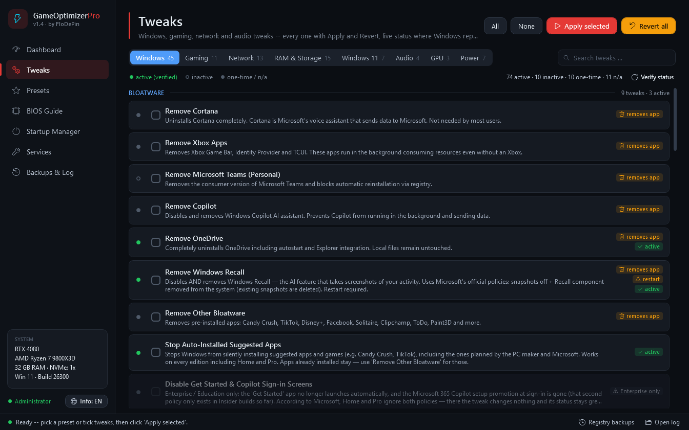
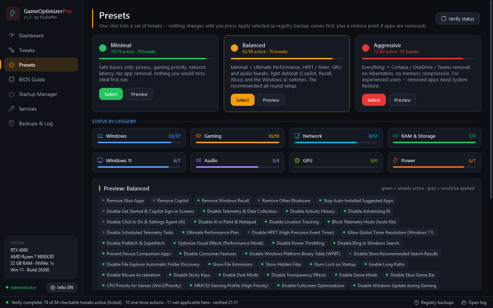
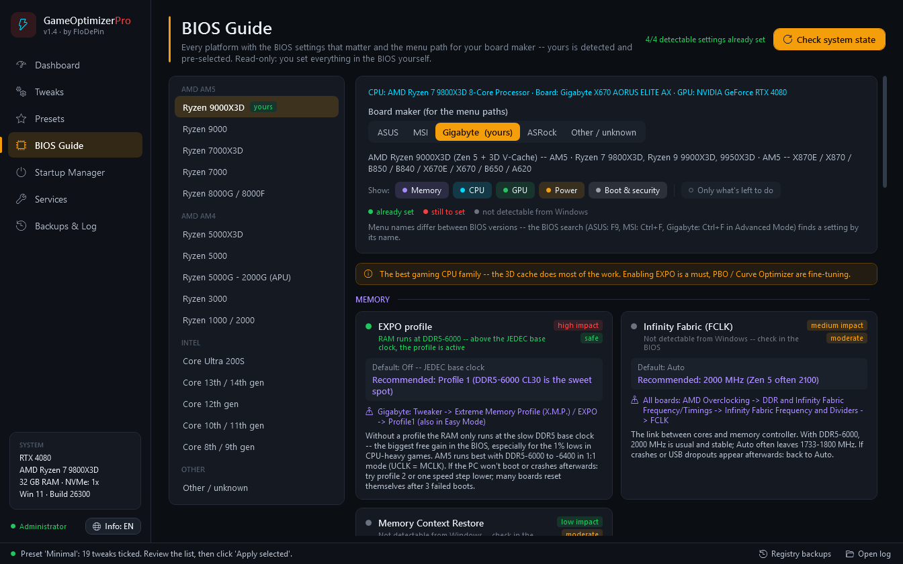
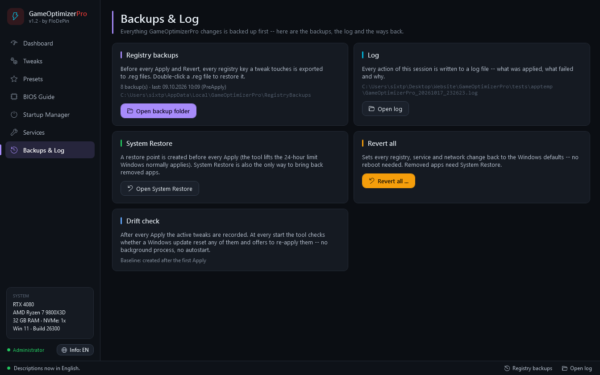

<div align="center">

# ⚡ GameOptimizerPro

**Windows & gaming optimizer in a single PowerShell script.**<br>
113 tweaks — every one can be undone, and you can see which ones are active.

[](https://github.com/FloDePin/GameOptimizerPro/releases/latest)
[](#-requirements)
[](#-requirements)
[](LICENSE)

**English** · [Deutsch](README.de.md)



</div>

## 🚀 Quick start

Open **PowerShell** and paste:

```powershell
irm https://raw.githubusercontent.com/FloDePin/GameOptimizerPro/main/install.ps1 | iex
```

The installer downloads the script, checks its SHA256 against [CHECKSUMS.txt](CHECKSUMS.txt) and starts it with administrator rights (Windows asks once). **Nothing changes until you click _Apply selected_** — and before that, a restore point and a registry backup are created.

<details>
<summary><b>Rather read the script before running it?</b></summary>

```powershell
irm https://raw.githubusercontent.com/FloDePin/GameOptimizerPro/main/GameOptimizerPro.ps1 -OutFile GameOptimizerPro.ps1
Get-FileHash .\GameOptimizerPro.ps1 -Algorithm SHA256    # must match CHECKSUMS.txt
# then, in a PowerShell opened as administrator:
powershell -ExecutionPolicy Bypass -File .\GameOptimizerPro.ps1
```

</details>

## ✨ Why GameOptimizerPro

- ↩️ **Every tweak can be undone** — each of the 113 tweaks has its own revert that goes back to the Windows default.
- 🟢 **You see what is active** — 103 tweaks have a live status check read straight from Windows (registry, services, power plan), not from a list of what you once clicked.
- 🔄 **Notices when Windows resets your tweaks** — updates like to switch things back. At start the app compares with your last Apply and offers to re-apply what was reverted.
- 🛟 **Safety net before every change** — a System Restore point plus a `.reg` backup of every affected key, before every Apply and Revert.
- 🧾 **Honest descriptions** — every tweak says what it does, what it costs and where Windows ignores it (e.g. policies that only work on Enterprise / Education).
- 🌍 **English & German** — all tweak descriptions and the whole BIOS Guide, switchable live.

## 📸 Screenshots

<table>
<tr>
<td width="50%"><br><sub><b>Tweaks</b> — status dot, badges and a description for every tweak; search across all categories</sub></td>
<td width="50%"><br><sub><b>Presets</b> — Minimal, Balanced, Aggressive with a preview of what is already active</sub></td>
</tr>
<tr>
<td width="50%"><br><sub><b>BIOS Guide</b> — your platform pre-selected, menu path for your board maker, live check of EXPO/XMP, ReBAR, CSM, Secure Boot</sub></td>
<td width="50%"><br><sub><b>Backups & Log</b> — registry backups, System Restore, Revert all and the log in one place</sub></td>
</tr>
</table>

## 🧰 What's inside

| Category | Tweaks | Examples |
|---|:---:|---|
| 🪟 Windows | 46 | Debloat (Copilot, Recall, OneDrive, auto-installed suggested apps), telemetry & privacy, the Windows AI switches, Ultimate Performance, HPET / timer, quality of life |
| 🎮 Gaming | 12 | Game Mode, MMCSS, CPU priority, fullscreen optimizations, MSI mode, HAGS, NVIDIA Reflex, GPU timeout (TDR) |
| 🌐 Network | 13 | Nagle, LSO, network throttling, DNS (Cloudflare / Google), TCP, QoS, Energy-Efficient Ethernet, interrupt moderation, adapter power saving |
| 💾 RAM & Storage | 15 | Page file, memory compression, TRIM, NVMe, write cache, hibernation + **Deep Clean** (6 cleanups, each shows the MB it freed) |
| 🪟 Windows 11 | 7 | Classic right-click menu, left taskbar, widgets, Start recommendations, End Task |
| 🔊 Audio | 6 | Audio enhancements, MMCSS audio, spatial sound, sound scheme, device power saving |
| 🖥️ GPU | 7 | 4 NVIDIA + 3 AMD driver tweaks — only offered for the GPU you actually have |
| ⚡ Power | 7 | USB / PCIe power saving, disk and system sleep, display timeout, CPU min / max state |

<details>
<summary><b>Show all 113 tweaks</b></summary>

**🪟 Windows (46)**

- *Bloatware:* Remove Cortana · Remove Xbox Apps · Remove Microsoft Teams (Personal) · Remove Copilot · Remove OneDrive · Remove Windows Recall · Remove Other Bloatware · Stop Auto-Installed Suggested Apps · Disable Get Started & Copilot Sign-in Screens
- *Privacy:* Disable Telemetry & Data Collection · Disable Activity History · Disable Advertising ID · Disable Text & Image Generation (AI) · Disable Click to Do & Settings Agent (AI) · Disable AI in Paint & Notepad · Disable Location Tracking · Block Telemetry Hosts (hosts file) · Disable Scheduled Telemetry Tasks · Disable Windows Settings Backup (Cloud)
- *Performance:* Ultimate Performance Plan · Disable HPET (High Precision Event Timer) · Allow Global Timer Resolution (Windows 11) · Disable Prefetch & Superfetch · Optimize Visual Effects (Performance Mode) · Disable Windows Search Indexing · Disable Power Throttling · Disable Bing in Windows Search · Process Count Reduction (Svchost)
- *CTT Essentials:* Prevent Device Companion Apps · Disable Consumer Features · Disable Windows Platform Binary Table (WPBT) · Disable Store Recommended Search Results · Enable Start Menu Previous Layout · Disable File Explorer Automatic Folder Discovery · Run Disk Cleanup
- *Quality of Life:* Show File Extensions · Show Hidden Files · Disable Reserved Storage · Disable Storage Sense · Num Lock on Startup · Disable Lock Screen · Enable Long Paths
- *Mouse & UI:* Disable Mouse Acceleration · Disable Sticky Keys · Enable Dark Mode · Disable Transparency Effects

**🎮 Gaming (12)**

- *In-Game Boosts:* Enable Game Mode · Disable Xbox Game Bar · CPU Priority for Games (Win32Priority) · MMCSS Gaming Profile (High Priority) · Disable Fullscreen Optimizations · Disable Windows Update during Gaming · Disable Background App Throttling
- *GPU & Driver:* NVIDIA Low Latency Mode (Reflex) · Enable MSI Mode (Message Signaled Interrupts) · Enable Hardware-Accelerated GPU Scheduling (HAGS) · Clear Shader Cache · Increase GPU Timeout Tolerance (TDR)

**🌐 Network (13)**

- *Latency:* Disable Nagle's Algorithm (TCPNoDelay) · Disable Large Send Offload (LSO) · Disable Network Throttling Index
- *DNS:* Set DNS to Cloudflare (1.1.1.1) · Set DNS to Google (8.8.8.8) · Flush DNS Cache
- *TCP:* Disable TCP Auto-Tuning · Optimize TCP Settings (ECN/SACK/Timestamps)
- *QoS:* Disable QoS Packet Scheduler Limit
- *Adapter:* Disable Network Adapter Power Saving · Disable Delivery Optimization (P2P Windows Update) · Disable Energy-Efficient Ethernet · Disable Interrupt Moderation

**💾 RAM & Storage (15)**

- *Page File:* Optimize PageFile (System Managed) · Clear PageFile on Shutdown
- *Memory:* Disable Memory Compression
- *SSD & NVMe:* Enable SSD TRIM · Disable Scheduled Defragmentation · Optimize NVMe Queue Depth · Disable Write-Cache Buffer Flushing
- *Maintenance:* Disable Hibernation · Clean Temp Files
- *Deep Clean:* Clean Browser Caches · Clean Windows Update Cache · Clean Thumbnail Cache · Empty Recycle Bin · Clean Prefetch Data · Clean System Logs & Crash Dumps

**🪟 Windows 11 (7)**

- *Taskbar & Shell:* Restore Classic Right-Click Menu · Left-Align Taskbar · Disable Widgets · Remove Chat Icon from Taskbar · Enable End Task in Taskbar
- *Start Menu:* Disable Recommended in Start Menu
- *Window Management:* Disable Snap Layout Hover Menu

**🔊 Audio (6)**

- *Latency & Quality:* Disable Audio Enhancements · Optimize MMCSS Audio Profile · Set Audio Service High Priority · Disable Spatial Sound (Windows Sonic)
- *System Sounds:* Disable Windows Sound Scheme
- *Power:* Disable Audio Device Power Save

**🖥️ GPU (7)**

- *NVIDIA:* NVIDIA: Disable Threaded Optimization · NVIDIA: Max Pre-Rendered Frames = 1 · NVIDIA: Shader Cache Size (Unlimited) · NVIDIA: Power Management = Max Performance
- *AMD:* AMD: Disable ULPS (Ultra Low Power State) · AMD: Shader Cache (Unlimited) · AMD: Anti-Lag (Low Latency Mode)

**⚡ Power (7)**

- *USB & PCI:* Disable USB Selective Suspend · Disable PCI-E Link State Power Management
- *Storage:* Disable Hard Disk Sleep
- *Display:* Set Display Sleep = 15 Minutes
- *Sleep:* Disable Sleep (System)
- *CPU:* CPU Minimum Processor State = 100% · CPU Maximum Processor State = 100%

</details>

### 🎚️ Presets

| Preset | Tweaks | For whom |
|---|:---:|---|
| 🟢 **Minimal** | 19 | Safe basics: privacy, gaming priority, network latency. No app removal — the ideal first run. |
| 🟠 **Balanced** | 83 | Minimal + Ultimate Performance, timer, GPU and audio tweaks, light debloat (Copilot, Recall, Xbox) and the Windows AI switches. The recommended all-round setup. |
| 🔴 **Aggressive** | 99 | Everything, incl. Cortana / OneDrive / Teams removal, no hibernation, no memory compression. For experienced users. |

A preset only ticks the boxes — you review the list and click **Apply selected** yourself.

### 🛠️ Tools

- 📊 **Dashboard** — hardware overview, optimization score, monitor refresh-rate check, live CPU / RAM / disk / network monitor, ping test (latency, packet loss, jitter), snapshot & compare
- 🔧 **BIOS Guide** — 16 platforms (AM5, AM4, Intel LGA1851 / 1700 / 1200 / 1151), menu paths for ASUS, MSI, Gigabyte and ASRock, live check of EXPO/XMP, Resizable BAR, CSM and Secure Boot. Read-only: you change the BIOS yourself
- 🚀 **Startup Manager** — Run keys and startup folders, disable / enable the same way Task Manager does — nothing is deleted
- ⚙️ **Services** — asks before touching critical services like Windows Update, BITS or the print spooler
- 🗄️ **Backups & Log** — registry backups, System Restore, Revert all, log file

## 🛡️ Safety

- **Restore point + registry backup** before every Apply and Revert — the `.reg` files are kept in `%LOCALAPPDATA%\GameOptimizerPro\RegistryBackups`
- **Removed apps** (Cortana, OneDrive, …) are the one thing a revert can't reinstall — they come back via System Restore. Those tweaks are marked *removes app*
- **SHA256 chain** — `install.ps1` only runs a script whose hash matches [CHECKSUMS.txt](CHECKSUMS.txt)
- **No background process, no telemetry** — the check for reverted tweaks runs only when you start the app
- **Open source** — one readable PowerShell file; every action is logged to `%TEMP%\GameOptimizerPro_*.log`

## 📋 Requirements

- **Windows 11** or **Windows 10 22H2** (Windows-11-only tweaks are greyed out on Windows 10)
- **Windows PowerShell 5.1** — built into Windows
- **Administrator rights** — the installer asks for them
- GPU tab: **NVIDIA** or **AMD** graphics card (with Intel Arc all other tweaks work)

## ❓ FAQ

<details>
<summary><b>How do I undo everything?</b></summary>

**Backups & Log → Revert all** sets every tweak back to the Windows default. Alternatively use the restore point *GameOptimizerPro Backup* in Windows System Restore.
</details>

<details>
<summary><b>Some tweaks have a grey dot instead of a green or empty one.</b></summary>

Grey means there is nothing lasting to check (one-time cleanups) or Windows can't report the status right now — for example while it is installing updates. **Verify status** checks again.
</details>

<details>
<summary><b>Microsoft Defender reports "HostsFileHijack".</b></summary>

That comes from *Block Telemetry Hosts*: Defender flags hosts entries that block Microsoft servers. Allow it in Defender, or revert the tweak — the other telemetry tweaks work without it.
</details>

<details>
<summary><b>"Running scripts is disabled on this system".</b></summary>

Only happens when you start the `.ps1` file directly. Use `powershell -ExecutionPolicy Bypass -File .\GameOptimizerPro.ps1` — the one-liner above isn't affected.
</details>

## 🧩 Also by FloDePin

[**GameOptimizerPro v2**](https://github.com/FloDePin/GameOptimizerPro-v2) — a separate desktop app (Python) with a GPU auto-tuner for overclocking and undervolting via MSI Afterburner.

## 🤝 Feedback

Found a bug or have an idea? Open an [issue](https://github.com/FloDePin/GameOptimizerPro/issues) — for bugs please add your Windows build and the log file (`%TEMP%\GameOptimizerPro_*.log`). What changed in each version: [Releases](https://github.com/FloDePin/GameOptimizerPro/releases). Security issue? Please report it privately — see [SECURITY.md](SECURITY.md).

## 📄 License

[MIT](LICENSE) © FloDePin — use at your own risk. Read the descriptions before applying tweaks; a restore point is created automatically.
