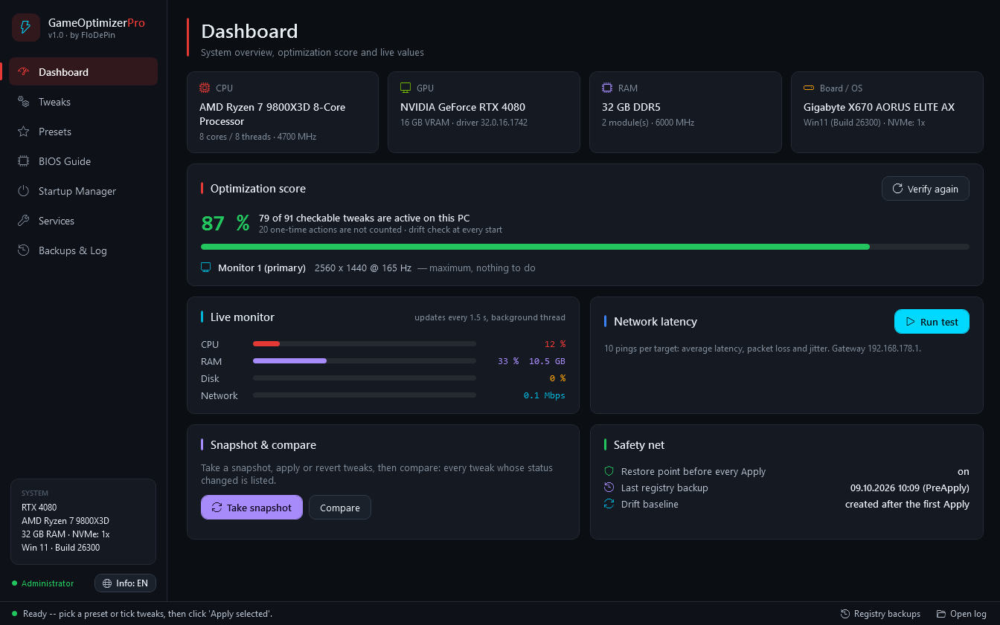
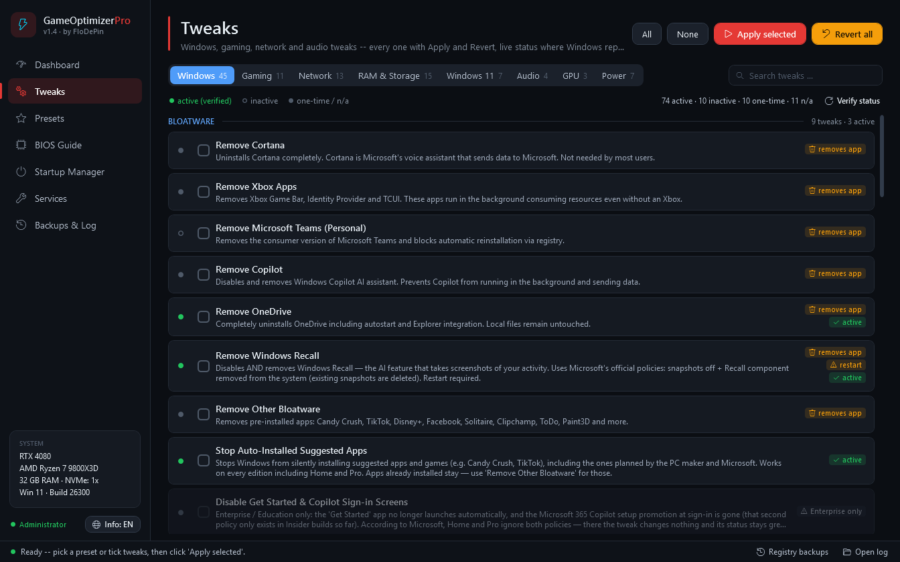
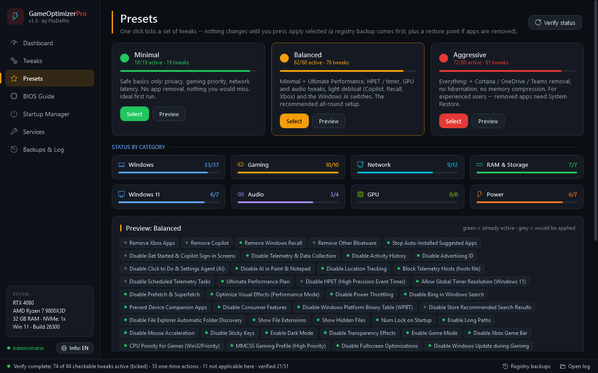
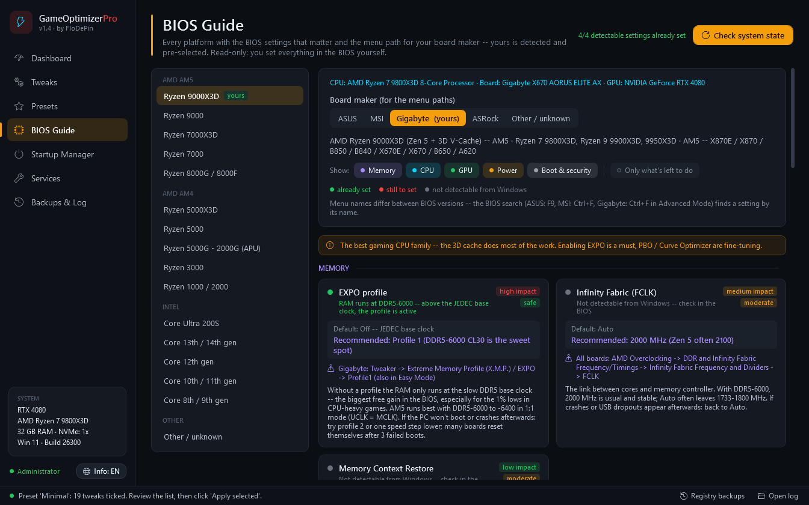
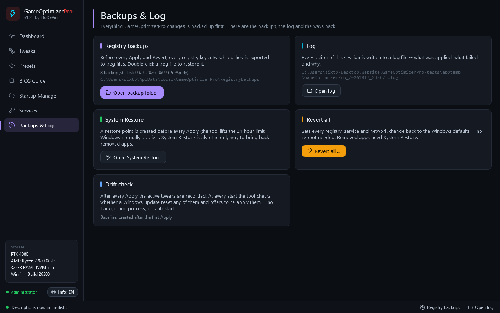

<div align="center">

# ⚡ GameOptimizerPro

**Windows & gaming optimizer in a single PowerShell script.**<br>
108 tweaks — every setting can be undone, and you can see which ones are active.

[](https://github.com/FloDePin/GameOptimizerPro/releases/latest)
[](#-requirements)
[](#-requirements)
[](LICENSE)

**English** · [Deutsch](README.de.md)



</div>

## 🚀 Quick start

Open **PowerShell** and paste:

```powershell
irm https://raw.githubusercontent.com/FloDePin/GameOptimizerPro/main/install.ps1 | iex
```

The installer downloads the script, checks its SHA256 against [CHECKSUMS.txt](CHECKSUMS.txt) and starts it with administrator rights (Windows asks once). **Nothing changes until you click _Apply selected_** — and before that, a registry backup is saved (plus a restore point whenever apps are removed — if System Protection is off, you are asked first).

<details>
<summary><b>Rather read the script before running it?</b></summary>

```powershell
irm https://raw.githubusercontent.com/FloDePin/GameOptimizerPro/main/GameOptimizerPro.ps1 -OutFile GameOptimizerPro.ps1
Get-FileHash .\GameOptimizerPro.ps1 -Algorithm SHA256    # must match CHECKSUMS.txt
# then, in a PowerShell opened as administrator:
powershell -ExecutionPolicy Bypass -File .\GameOptimizerPro.ps1
```

</details>

## ✨ Why GameOptimizerPro

- ↩️ **Every setting can be undone** — each of the 108 tweaks has its own revert back to the Windows default — everything the app applied at once (*Revert all*; settings you made yourself stay) or just the ones you tick (*Revert selected*). Only two kinds are one-way: app removals (they come back through the Microsoft Store or System Restore) and the cleanups (deleted cache files stay deleted).
- 🟢 **You see what is active** — 98 tweaks have a live status check read straight from Windows (registry, services, power plan), not from a list of what you once clicked.
- 🔄 **Notices when Windows resets your tweaks** — updates like to switch things back. At start the app compares with your last Apply and offers to re-apply what was reverted.
- 🛟 **Safety net before every change** — a `.reg` backup of every affected key before every Apply and Revert, plus a System Restore point whenever apps are removed.
- 🧾 **Honest descriptions** — every tweak says what it does, what it costs and where Windows ignores it (e.g. policies that only work on Enterprise / Education).
- 🌍 **English & German** — all tweak descriptions and the whole BIOS Guide, switchable live.

## 📸 Screenshots

<table>
<tr>
<td width="50%"><br><sub><b>Tweaks</b> — status dot, badges and a description for every tweak; search across all categories</sub></td>
<td width="50%"><br><sub><b>Presets</b> — Minimal, Balanced, Aggressive with a preview of what is already active</sub></td>
</tr>
<tr>
<td width="50%"><br><sub><b>BIOS Guide</b> — your platform pre-selected, menu path for your board maker, live check of EXPO/XMP, ReBAR, CSM, Secure Boot</sub></td>
<td width="50%"><br><sub><b>Backups & Log</b> — registry backups, System Restore, Revert all and the log in one place</sub></td>
</tr>
</table>

## 🧰 What's inside

| Category | Tweaks | Examples |
|---|:---:|---|
| 🪟 Windows | 53 | Debloat (Copilot, Recall, OneDrive, suggested apps, tips & ads), telemetry & privacy, the Windows AI switches, Windows Update control, background apps, Ultimate Performance, HPET / timer, quality of life |
| 🎮 Gaming | 9 | Game Mode, MMCSS, CPU priority, fullscreen optimizations, MSI mode, HAGS, GPU timeout (TDR) |
| 🌐 Network | 11 | Nagle, LSO, network throttling, DNS (Cloudflare / Google, IPv4 + IPv6), TCP auto-tuning, Energy-Efficient Ethernet, interrupt moderation, adapter power saving |
| 💾 RAM & Storage | 14 | Page file, memory compression, TRIM, write cache, hibernation + **Deep Clean** (6 cleanups, each shows the MB it freed) |
| 🪟 Windows 11 | 7 | Classic right-click menu, left taskbar, widgets, Start recommendations, End Task, Dynamic Lighting |
| 🔊 Audio | 4 | Audio enhancements, MMCSS audio, audio service priority, sound scheme |
| 🖥️ GPU | 1 | AMD: ULPS (Ultra Low Power State). NVIDIA keeps its driver settings in the NVIDIA app, not in the registry |
| ⚡ Power | 9 | USB / USB 3 / PCIe power saving, disk and system sleep, wake timers, display timeout, CPU min / max state |

<details>
<summary><b>Show all 108 tweaks</b></summary>

**🪟 Windows (53)**

- *Bloatware:* Remove Xbox Apps · Remove Copilot · Remove OneDrive · Remove Windows Recall · Remove Other Bloatware · Stop Auto-Installed Suggested Apps · Disable Tips, Ads & Suggestions · Stop OneDrive Folder Backup · Disable Get Started & Copilot Sign-in Screens
- *Privacy:* Disable Telemetry & Data Collection · Disable Activity History · Disable Advertising ID · Disable Text & Image Generation (AI) · Disable Click to Do & Settings Agent (AI) · Disable AI in Paint & Notepad · Disable Location Tracking · Block Telemetry Hosts (hosts file) · Disable Scheduled Telemetry Tasks · Disable Input & Speech Data Collection · Disable Remote Assistance
- *Performance:* Ultimate Performance Plan · Disable HPET (High Precision Event Timer) · Allow Global Timer Resolution (Windows 11) · Disable Prefetch & Superfetch · Optimize Visual Effects (Performance Mode) · Disable Startup App Delay · Disable Windows Search Indexing · Disable Power Throttling · Disable Bing in Windows Search · Process Count Reduction (Svchost) · Block Background Apps (Policy) · Stop Background Apps (All Editions)
- *Windows Update:* Exclude Drivers from Windows Update · Hold Feature Updates (Stay on Current Version) · Disable Automatic Windows Updates
- *CTT Essentials:* Prevent Device Companion Apps · Disable Consumer Features · Disable Windows Platform Binary Table (WPBT) · Disable Store Recommended Search Results · Disable File Explorer Automatic Folder Discovery · Run Disk Cleanup
- *Quality of Life:* Show File Extensions · Show Hidden Files · Disable Reserved Storage · Disable Storage Sense · Num Lock on Startup · Disable Lock Screen · Enable Long Paths
- *Mouse & UI:* Disable Mouse Acceleration · Disable Sticky Keys · Enable Dark Mode · Disable Transparency Effects · Alt+Tab Without Browser Tabs

**🎮 Gaming (9)**

- *In-Game Boosts:* Enable Game Mode · Disable Xbox Game Bar · CPU Priority for Games (Win32Priority) · MMCSS Gaming Profile (High Priority) · Disable Fullscreen Optimizations
- *GPU & Driver:* Enable MSI Mode (Message Signaled Interrupts) · Enable Hardware-Accelerated GPU Scheduling (HAGS) · Clear Shader Cache · Increase GPU Timeout Tolerance (TDR)

**🌐 Network (11)**

- *Latency:* Disable Nagle's Algorithm (TCPNoDelay) · Disable Large Send Offload (LSO) · Disable Network Throttling Index
- *DNS:* Set DNS to Cloudflare (1.1.1.1) · Set DNS to Google (8.8.8.8) · Flush DNS Cache
- *TCP:* Disable TCP Auto-Tuning
- *Adapter:* Disable Network Adapter Power Saving · Disable Delivery Optimization (P2P Windows Update) · Disable Energy-Efficient Ethernet · Disable Interrupt Moderation

**💾 RAM & Storage (14)**

- *Page File:* Optimize PageFile (System Managed) · Clear PageFile on Shutdown
- *Memory:* Disable Memory Compression
- *SSD & NVMe:* Enable SSD TRIM · Disable Scheduled Defragmentation · Disable Write-Cache Buffer Flushing
- *Maintenance:* Disable Hibernation · Clean Temp Files
- *Deep Clean:* Clean Browser Caches · Clean Windows Update Cache · Clean Thumbnail Cache · Empty Recycle Bin · Clean Prefetch Data · Clean System Logs & Crash Dumps

**🪟 Windows 11 (7)**

- *Taskbar & Shell:* Restore Classic Right-Click Menu · Left-Align Taskbar · Disable Widgets · Enable End Task in Taskbar
- *Start Menu:* Disable Recommended in Start Menu
- *Window Management:* Disable Snap Layout Hover Menu
- *Devices:* Disable Dynamic Lighting

**🔊 Audio (4)**

- *Latency & Quality:* Disable Audio Enhancements · Optimize MMCSS Audio Profile · Set Audio Service High Priority
- *System Sounds:* Disable Windows Sound Scheme

**🖥️ GPU (1)**

- *AMD:* AMD: Disable ULPS (Ultra Low Power State)

**⚡ Power (9)**

- *USB & PCI:* Disable USB Selective Suspend · Disable USB 3 Link Power Management · Disable PCI-E Link State Power Management
- *Storage:* Disable Hard Disk Sleep
- *Display:* Set Display Sleep = 15 Minutes
- *Sleep:* Disable Sleep (System) · Disable Wake Timers
- *CPU:* CPU Minimum Processor State = 100% · CPU Maximum Processor State = 100%

</details>

### 🎚️ Presets

| Preset | Tweaks | For whom |
|---|:---:|---|
| 🟢 **Minimal** | 18 | Safe basics: privacy, gaming priority, network latency. No app removal — the ideal first run. |
| 🟠 **Balanced** | 73 | Minimal + Ultimate Performance, timer, GPU and audio tweaks, light debloat (Copilot, Recall, tips & ads) and the Windows AI and privacy switches. The recommended all-round setup. |
| 🔴 **Aggressive** | 89 | Everything, incl. Xbox and OneDrive removal, no background Store apps, no drivers from Windows Update, no hibernation, no memory compression. For experienced users. |

A preset only ticks the boxes — you review the list and click **Apply selected** yourself. Tweaks that are already active are left as they are. On purpose in no preset: turning off automatic Windows updates or TCP auto-tuning, the scheduled drive optimization, holding feature updates, the DNS providers and a few matters of taste.

### 🛠️ Tools

- 📊 **Dashboard** — hardware overview, optimization score (against the recommended Balanced preset), notice when a newer release is out, monitor refresh-rate check, live CPU / RAM / disk / network monitor, ping test (latency, packet loss, jitter), snapshot & compare (kept after a restart, e.g. across a Windows update)
- 🔧 **BIOS Guide** — 16 platforms (AM5, AM4, Intel LGA1851 / 1700 / 1200 / 1151), menu paths for ASUS, MSI, Gigabyte and ASRock, live check of EXPO/XMP, Resizable BAR, CSM and Secure Boot. Read-only: you change the BIOS yourself
- 🚀 **Startup Manager** — Run keys, startup folders and the startup tasks of Store apps, disable / enable the same way Task Manager does — nothing is deleted; the boot delay Windows measured, where it logged one
- ⚙️ **Services** — asks before touching critical services like Windows Update, BITS or the print spooler; *Enable* brings back the start type a service had before
- 🗄️ **Backups & Log** — registry backups, System Restore, Revert all, log file
- 💾 **Your own selection** — save the ticked tweaks to a text file (Presets page) and tick them again after a reinstall or on a second PC

## 🛡️ Safety

- **Registry backup** before every Apply and Revert — the `.reg` files are kept in `%LOCALAPPDATA%\GameOptimizerPro\RegistryBackups` (the newest 20 of this app, about 3 MB each). Double-clicking one puts the saved values back; `_remove-new-keys.reg` deletes keys that did not exist yet. **A restore point** comes on top whenever an Apply removes apps
- **Removed apps** (OneDrive, Xbox, …) are the one thing a revert can't reinstall — they come back through the Microsoft Store (OneDrive: its installer) or System Restore. If System Protection is off, the app asks before removing anything. Those tweaks are marked *removes app*
- **SHA256 chain** — `install.ps1` only runs a script whose hash matches [CHECKSUMS.txt](CHECKSUMS.txt), and starts exactly those bytes from a folder only administrators can write to
- **No background process, no telemetry** — the check for reverted tweaks runs only when you start the app. The one network request: at start, a look at GitHub for a newer release (nothing is sent)
- **Open source** — one readable PowerShell file; every action is logged to `%TEMP%\GameOptimizerPro_*.log`

## 📋 Requirements

- **Windows 11** or **Windows 10 22H2** (Windows-11-only tweaks are greyed out on Windows 10; policies Windows Home or Pro ignore are greyed out there, marked *Pro and up* / *Enterprise only*)
- **Windows PowerShell 5.1** — built into Windows
- **Administrator rights** — the installer asks for them
- GPU tab: **AMD** graphics cards only (all other tweaks work with any card)

## ❓ FAQ

<details>
<summary><b>How do I undo everything?</b></summary>

**Backups & Log → Revert all** sets every tweak GameOptimizerPro applied back to the Windows default; settings you made yourself stay. Removed apps come back through the Microsoft Store or the restore point *GameOptimizerPro Backup* (created before app removals) in Windows System Restore.
</details>

<details>
<summary><b>Some tweaks have a grey dot instead of a green or empty one.</b></summary>

Grey means there is nothing lasting to check (one-time cleanups), the tweak doesn't apply to this PC (AMD tweaks on an NVIDIA card, a network adapter without that setting) or Windows can't report the status right now — for example while it is installing updates. The counters list one-time actions and “n/a” separately. **Verify status** checks again.
</details>

<details>
<summary><b>Microsoft Defender reports "HostsFileHijack".</b></summary>

That comes from *Block Telemetry Hosts*: Defender flags hosts entries that block Microsoft servers. Allow it in Defender, or revert the tweak — the other telemetry tweaks work without it.
</details>

<details>
<summary><b>"Running scripts is disabled on this system".</b></summary>

Only happens when you start the `.ps1` file directly. Use `powershell -ExecutionPolicy Bypass -File .\GameOptimizerPro.ps1` — the one-liner above isn't affected.
</details>

## 🧩 Also by FloDePin

[**GameOptimizerPro v2**](https://github.com/FloDePin/GameOptimizerPro-v2) — a separate desktop app (Python) with a GPU auto-tuner for overclocking and undervolting via MSI Afterburner.

## 🤝 Feedback

Found a bug or have an idea? Open an [issue](https://github.com/FloDePin/GameOptimizerPro/issues) — for bugs please add your Windows build and the log file (`%TEMP%\GameOptimizerPro_*.log`). What changed in each version: [CHANGELOG.md](CHANGELOG.md). Security issue? Please report it privately — see [SECURITY.md](SECURITY.md).

## 📄 License

[MIT](LICENSE) © FloDePin — use at your own risk. Read the descriptions before applying tweaks; a registry backup is saved automatically, plus a restore point before app removals.
